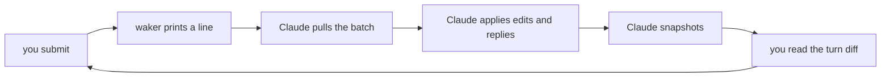

# agent-coop

A shared review surface. You and Claude work the same documents through a web
UI instead of trading messages in a chat transcript. A SQLite event log is the
source of truth; markdown files are exports, never inputs.

**The problem.** Working with Claude on anything complex, your bandwidth back
to the model becomes the bottleneck. Precise feedback degrades into copy-paste
quoting: paste a fragment, describe its location in prose, explain the change
in words, repeat. And an hour into a session comes the fog: the document has
been rewritten four times, your earlier asks are lost in the scroll, and chat
has no answer to "what changed since I last looked?"

**The solution.** agent-coop gives the work a surface instead of a scroll. Select
text and comment on it, the way you would in any document review. Annotate
freely, then submit once: Claude gets the whole batch, works, and the diff
that comes back is scoped to your last submit, word-level, with every change
attributed to whoever made it. Neither of you runs ahead: that is what the
name means. The longer story is in [docs/why.md](docs/why.md).

- You edit blocks, select text, leave comments, then press **Submit for review**.
- Claude is woken by that submit, pulls the batch, applies edits, answers
  comments, and records a one-line summary.
- The browser shows you a diff of what changed since your last submit, with each
  change attributed to whoever made it.
- One process owns the database. Claude reaches it over MCP, as a client, never
  as a second writer.

## Quickstart

Requires [Bun](https://bun.sh) and [Claude Code](https://claude.com/claude-code).
Full prerequisites and the directory layout are in [docs/install.md](docs/install.md).

```
git clone <this repo> agent-coop
cd agent-coop
bun install
bun run scripts/up.ts
```

`scripts/up.ts` health-checks the port, starts the server if it is down, chooses
or creates a session, and prints three lines at most:

```
started agent-coop
created session s-…
http://localhost:4317/session/s-…
```

Open that URL. Inside Claude Code, in this repo, run `/agent-coop` instead: the skill
runs the same command and then arms the waker, which is what makes a submit
reach Claude.

The port is `4317` unless `AGENT_COOP_PORT` says otherwise
(`src/server/paths.ts`).

## Running the pieces

- Dev server: `bun run scripts/dev.ts` — starts the single server process.
- Bring the whole thing up the way `/agent-coop` does: `bun run scripts/up.ts`, then
  `scripts/watch.ts` under the Monitor tool (the waker).
- DB reset: `bun run scripts/db-reset.ts`.
- Seed a demo session: `bun run scripts/seed.ts`.
- Rebuild the UI: `bun run scripts/build.ts` — regenerates
  `web/src/contract.gen.js` first, then `cleanDist()` (the recursive delete, its
  own named step), then `copyStatic()`, which only copies. Do not fold the
  delete back into a function whose name does not say it deletes.

The plugin launcher serves `static/`, a separate snapshot. From this directory,
run `bun install`, then `bun run build` to rebuild `web/dist/`; updating the
snapshot also needs copying that output into `static/`. The snapshot was not
rebuilt in the offline audit. Its `app.js` is dated October 23, 2026, while
`app.js.map` is dated October 22 and embeds seven sources that differ from the
current `web/src/` files.

## The loop



Every arrow is an event on the log. Nothing in the loop holds a turn open: the
waiting happens on the harness side, outside agent-coop.

## What makes Claude act

Nothing in agent-coop can make Claude act on its own. SSE reaches browsers only, MCP is
request/response, and Claude Code starts a turn only when something outside agent-coop
wakes it. Without a trigger, every turn ends with the user leaving the surface
to type "done" in the terminal, which is the one thing agent-coop exists to avoid.

**One channel, and agent-coop's half of it is dumb.** Agent Coop answers "is a submit
waiting?" and will hold the answer open. It does not wait, retry, remember, or
decide when Claude runs. Everything that waits is on the harness side of the seam.

| Piece | Where | Job |
|---|---|---|
| `GET /api/turn/wait` | `src/server/routes/read.ts` | hold one request open until a submit is visible, or the timeout. Pure read |
| `GET /api/turn/pending` | same | the same answer without holding |
| `scripts/watch.ts` | harness side | long-poll that channel and print one line per NEW submit |
| the Monitor tool | Claude Code | run that script for the session's lifetime; each line becomes a wake-up |

The `/agent-coop` skill arms the monitor once, at start, and then works in ordinary
turns: a notification arrives, Claude pulls, applies, snapshots, and **ends the
turn**. No turn is ever held open waiting for the user.

### Why no MCP tool may wait

There was a wait tool on the `agent_coop_*` surface. It is gone; the endpoint it called
is not. The reason is measured, not aesthetic: an
MCP client request that outlives the client's own request timeout fails the whole
tool call with JSON-RPC **`-32001` (request timed out)**, so "the user is
thinking" surfaced as a broken tool call rather than as `pending: false`. The
server's cap cannot defend against a bound it cannot see. Holding a request is
therefore a job for something whose failure is cheap, a shell command the harness
supervises, and never for a tool call inside Claude's turn.

### The residual gap, and the fallback

There is **one**, and it is at the start. **A submit that lands while nothing is
armed reaches nobody until the user says something in chat.** That is one chat
message, once, to start `/agent-coop`. After that the monitor is armed for the session
and Claude's own idleness costs nothing, because the waiting is not Claude's to
do. If the Monitor tool is unavailable in a session, the skill says so in one
sentence and the user nudges in chat; there is no second mechanism.

A wake that reached nobody is sent again by the waker rather than stranded
(`TURN_WATCH_REANNOUNCE_MS`, `src/contract/turn.ts`), and a submit abandoned
overnight is cancelled by the periodic sweep (`src/server/maintenance.ts`,
`STALE_SUBMIT_MS`) using the same `cancel` event the "Take it back" button sends.

### v1 limitation: one repo

The `agent_coop_*` tools are registered per project (`.mcp.json` at this repo's root)
and the waker is a script in this repo, so working in agent-coop means running Claude
Code with its working directory set to the agent-coop repo or one of its worktrees.
From anywhere else the tools are simply absent and the skill's two commands do
not resolve. Making agent-coop usable on an arbitrary project is not done; it needs a
user-scope registration and a way to point the shim at a server started
elsewhere (`AGENT_COOP_URL` / `AGENT_COOP_PORT` already exist for the second half).

## Docs

| Page | Read it for |
|---|---|
| [docs/install.md](docs/install.md) | prerequisites, clone, the sibling `data/ artifacts/ history/` layout, verification |
| [docs/usage.md](docs/usage.md) | a working session end to end from your seat |
| [docs/how-it-works.md](docs/how-it-works.md) | event log, single writer, anchors, the trigger channel |
| [docs/security.md](docs/security.md) | what the loopback bind buys, what the guard checks, what v1 does not do |
| [docs/phone.md](docs/phone.md) | reaching the UI from a phone over a tailnet |
| [docs/invariants.md](docs/invariants.md) | hard boundaries and earned gotchas — each rule cites the review finding behind it |

`AGENTS.md` routes to [docs/invariants.md](docs/invariants.md), the
contributor's map of hard boundaries and the reasons behind them. Read it
before changing anything under `src/`.

## Repo layout

| Path | Holds | Must not |
|---|---|---|
| `src/contract/` | Zod schemas, TS types, `.sql` DDL in `migrations/` | contain logic |
| `src/engine/` | event log, reducer, projections, Yjs binding | know HTTP or MCP exists |
| `src/server/` | the one long-lived process: HTTP + SSE + Yjs + engine | hold business logic beyond routing |
| `src/mcp/` | stdio to localhost-HTTP shim | touch SQLite/Yjs directly |
| `src/transcribe/` | audio to a transcript: the seam, plus the `whisper` backend (whisper.cpp subprocess) | write the recording anywhere durable, or take a path instead of samples |
| `src/export/` | blocks to markdown writer | write outside the container's `artifacts/` (refused, SEC-3) |
| `src/speech/` | narration text to audio: the seam, plus the `kokoro` and `say` backends | let a unit test load the model or spawn the real `say` (inject a fake `SpeechBackend` instead) |
| `web/src/` | Web Components, one per file | reach data except via HTTP, or hand-copy a contract enum (`contract.gen.js`) |
| `web/dist/` | esbuild output (gitignored) | be edited by hand |
| `.claude/skills/agent-coop/` | the `/agent-coop` skill: brings agent-coop up, then arms the waker | contain logic, hold a turn open, or live anywhere else |
| `.claude/skills/narrate/` | the `/narrate` skill: turns a closed turn into a note and a narration, stores both with `agent_coop_note` | contain logic, build a new trigger/wake mechanism, or live anywhere else |
| `src/server/guard.test.ts` | dependency-free request guard tests added in this port | load the absent schema dependencies |
| `scripts/` | `dev.ts`, `db-reset.ts`, `build.ts`, `gen-contract.ts`, `up.ts`, `seed.ts`, `watch.ts` | open a second SQLite handle: only `up.ts` may, and only with no server up |
| `.mcp.json` | registers the `agent-coop` stdio MCP server for this project | name a port or URL: `src/mcp/index.ts` owns that default |

Single Bun package, no workspaces: one runtime, one deployable process. Yjs is
the one heavyweight dependency, and it is deliberate: it replaces three bespoke
heuristics (LCS block matching, token-overlap matching, fuzzy re-anchoring) with
deterministic relative positions.
