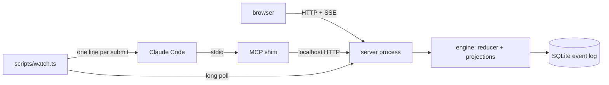

# How agent-coop works

- **The event log is the source of truth.** Every projection, including the
  session's turn state, is derived from it by one reducer. Nothing writes a
  projection directly.
- **One process writes.** `src/server` hosts the engine, HTTP, SSE and Yjs
  together and is the only thing that opens SQLite. MCP is a client of it.
- **Comment anchors are Yjs relative positions**, opaque end to end. The server
  resolves them on every read; the browser never decodes one.
- **Nothing inside agent-coop makes Claude act.** Agent Coop answers one question over HTTP
  and holds the answer open. The waiting lives outside, in a shell script the
  harness supervises.
- **Crash recovery is replay.** There is no resume path: a server restart and a
  dead Claude session are the same case.

## The pieces

| Part | Owns | Must not |
|---|---|---|
| `src/contract` | schemas, types, DDL, every length cap and timing constant | contain logic |
| `src/engine` | the log, the reducer, projections, the Yjs binding | know HTTP or MCP exists |
| `src/server` | the one process: routing, SSE, guards, anchors, diff | hold business logic beyond routing |
| `src/mcp` | a thin stdio to localhost-HTTP shim, 13 `agent_coop_*` tools | touch SQLite or Yjs, or wait |
| `web/src` | Web Components | reach data except over HTTP, or derive what changed |

## Event log and projections

A write is an event appended to the log. Everything else is derived.

| Layer | Example | Written by |
|---|---|---|
| events | `user_edit`, `submit`, `pull`, `claude_apply`, `cancel`, `snapshot`, `export`, `doc_added`, `comment_*` (full list: `EVENT_TYPES`) | the reducer, in one transaction |
| projections | `session_state`, `revision`, block content | the reducer only |
| rows that precede any event | `session`, `document` | the engine's creators; replay upserts rather than deletes them |

A write outside the reducer is a bug, not a shortcut. The turn state machine is
engine-enforced, so a block edit outside `USER_EDITING` returns 409 by design.
A refusal from the engine is a `DomainError` carrying `{ code, message, state }`
and no HTTP status: mapping a code to a status belongs to `src/server/errors.ts`,
and mapping an HTTP failure to an MCP error belongs to `src/mcp/tools.ts`.

The log is append-only and never truncated, which is why every string crossing
the seam is capped in `src/contract/limits.ts` (ids 256, paths 4096, bodies
65,536 characters) and the whole request body is capped by `Bun.serve`.

### Compaction and backups

A document at or over `COMPACTION_THRESHOLD` (200) update rows has them folded
into one merged snapshot by the periodic pass in `src/server/maintenance.ts`.
The engine schedules nothing itself: it answers which documents need it and
compacts one. Backups are full database copies in `history/`, capped at
`MAX_BACKUPS` (10) and pruned oldest-first.

## Single writer

The server is the only process that opens SQLite or touches Yjs. Two consequences
are visible from outside:

| Consequence | Why |
|---|---|
| there is no `POST /api/sessions` | creating a session names a local markdown file, and nothing the browser can reach may name a local path |
| `scripts/up.ts` refuses to create a session while a server is up | it may open the database only in the window where it has probed the port and found nothing |

`scripts/seed.ts` goes through `up()` rather than repeating that rule, and
`scripts/db-reset.ts` takes its path from `src/server/paths.ts` so `AGENT_COOP_DB`
names the same file the server opens.

## Comment anchors

An anchor is two opaque Yjs relative positions: a head (assoc 0) and a tail
(assoc -1). Neither is ever decoded, compared, or fuzzy-matched anywhere in the
stack.

| Field | Is | Is not |
|---|---|---|
| `relative_position`, `relative_position_end` | the anchor | readable |
| `quoted_text` | a human-readable pointer, display only | ever used to size a highlight |
| `rendered_offsets` | the anchor's current range, computed server-side on every read | ever derived by the client |
| `anchor_state` | `attached`, `detached`, or `orphaned`, decided by one function | a boolean |

Sizing a highlight as `head + quoted_text.length` was a real defect: after a
rewrite it marked the right number of the wrong words while the state still
claimed "attached". Only `attached` may be painted, and client code tests
`!== "attached"` so a future state cannot fall through into being drawn.

Yjs is the one heavyweight dependency and it earns its place here: it replaces
LCS block matching, token-overlap matching and fuzzy re-anchoring with
deterministic relative positions.

## The trigger channel

Agent Coop's half is deliberately dumb. It answers one question and never decides when
Claude runs.

| Piece | Side | Job |
|---|---|---|
| `GET /api/turn/pending` | agent-coop | is a submit waiting? Answers now |
| `GET /api/turn/wait` | agent-coop | the same question, held open until yes or the timeout |
| `scripts/watch.ts` | harness | long-poll, print one line per new submit |
| the Monitor tool | harness | run that script for the session's lifetime |

`wait` is a long poll on the broadcaster, not a poll of SQLite: it waits for the
same `state_changed` frame the browsers get, then re-reads the projection to
answer. Both endpoints are pure reads and neither consumes anything. Only
`POST /api/pull` consumes a submit.

Every timing number lives in `src/contract/turn.ts` and nowhere else. The watcher
imports the server's cap for its query, derives its own abort budget from it
(`+ TURN_WAIT_CLIENT_SLACK_MS`), and imports the three intervals it runs on. It
writes none of the five.

### Why no MCP tool may wait

An MCP client request that outlives the client's own request timeout fails the
whole tool call with JSON-RPC **`-32001` (request timed out)**. A tool that held
the wait therefore turned "the user is thinking" into a broken tool call rather
than into `pending: false`. The server's cap cannot defend against a bound it
cannot see. The tool was deleted and the endpoint kept its job; a test walks every
tool's mapped path and fails if one reaches `/api/turn/`.

### The watcher's one piece of state

`wait` answers instantly for as long as a submit sits unpulled, so a memoryless
loop would announce the same submit on every iteration for the whole of Claude's
turn. `(session_id, submit_seq)` identifies one submit and a line is emitted only
when that pair is new. The memory is in RAM, not on disk: losing it costs one
repeated wake-up.

It **expires** after `TURN_WATCH_REANNOUNCE_MS`, and the expiry is as load-bearing
as the memory. Remembering for ever is how a wake gets lost: a notification that
lands during an interrupted turn would never be repeated, and `pending` only
clears on a pull. Still unpulled after the interval means nothing acted on it, so
the line goes out again. The cost is one refused pull, and that refusal is itself
the all-clear.

An abandoned submit does not pin the channel. `pending` names the **most recent**
submit, so one forgotten session cannot hide every later one, and the maintenance
sweep cancels anything older than `STALE_SUBMIT_MS` through the same `cancel`
event the "Take it back" button sends.

## Turn notes and narration

A note is Claude's own interpretation of a turn — markdown for the eye,
flattened into `narration` for an ear — written on demand rather than for every
turn. Most revisions never have one.

| Piece | Is |
|---|---|
| trigger | the chat message itself; no button, no SSE, no wake channel |
| event | `note_written` (src/contract/events.ts): `doc_id`, `revision_id` (the LABEL), `note`, `narration` |
| projection | `revision.turn_note`/`revision.narration` (migrations/0003_turn_note.sql), found by `revisionRowIdForLabel` |
| read | `GET /api/revisions/:doc_id` — the same PI-5 endpoint, now carrying two more nullable fields |
| audio | a derived cache, rendered in the background after the note itself is already saved |

Asking in chat already starts a Claude turn, so a note needs none of the
machinery above: no `GET /api/turn/wait`, no watcher, no Monitor tool. That is
also why `note_written` is legal in every session state rather than
CLAUDE_TURN-only — the turn it describes has already closed by the time anyone
asks for a note, so gating it the way `claude_apply` is gated would refuse it
every time.

The audio is the one exception to "emit.ts is the one place an event becomes
SSE rows": `narration_ready`/`narration_failed` (src/contract/sse.ts) are
broadcast directly by `src/server/notes.ts`, because there is no event behind
them. `POST /api/notes/:doc_id` commits the note and returns before the render
starts — the same reason the rev-2 wait tool is gone: a `say` render can
outlive an MCP client's own request timeout. The file itself is regenerable
from `narration` at any time, so it lives under the container's `data/` and
touches neither the log nor a projection.

## What the browser is not allowed to do

| Question | Answered by | Not by |
|---|---|---|
| what changed this turn | `GET /api/diff` (`src/engine/diff.ts`, `src/server/worddiff.ts`) | the view |
| where a comment highlight goes | `rendered_offsets`, `src/server/anchors.ts` | the client |
| what a contract enum's values are | `web/src/contract.gen.js`, generated from `src/contract` | a hand-copied list |

The generated file is committed, and a test fails when it and a fresh render
disagree. A direct import is not possible: it would pull zod into the browser
bundle.

## Crash recovery

Replay from the event log. There is no separate resume path, so a server restart
and a Claude session that died mid-turn are the same case: boot replays the log,
projections come back, and the session is in whatever state its events say. A
session left holding `CLAUDE_TURN` by a dead Claude is freed by "Take it back", or
by the stale-submit sweep.

---

Next: [security.md](security.md). Back to [usage.md](usage.md) or
[install.md](install.md).
