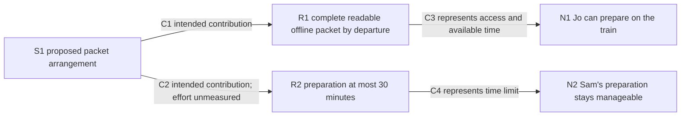

# A reading-circle packet: seven worked outputs

This is a fictional worked example authored to explain the plugin. It is not an
actual capability run or operating evidence. The criteria and participants are
stipulated local choices, not Manifold rules. A reader can enter at any section.
The [reference route](../references/index.md) identifies source meanings and standing.

## Supplied material

Case RC, model A. Source A1 is Jo's account: “I want to read the complete packet on
the train before our Sunday discussion; the train has no network.” Source A2 is
Sam's account: “I assemble it on Saturday. I want preparation to stay below half an
hour.” Source A3 is the existing model: “Shared cloud folder → everyone ready.”
Another participant, Lee, has provided no account. Jo and Sam are different people;
Jo chooses criteria for Jo's preparation and Sam chooses Sam's effort limit. No one
has authority to decide for Lee. These are source accounts, not independently
measured conditions.

<a id="orientation"></a>
## Orient and frame

The decision is how to share this week's reading packet so Jo can prepare during
the train journey without imposing excessive preparation work on Sam. The proposed
boundary includes compilation, delivery and Jo's access; the train's network
availability is environmental. Discussion quality is a later outcome, not something
proved by sending a link.

Declare `human.circle.reader` (Jo), `human.circle.compiler` (Sam), and
`human.circle.other.reader` (Lee, missing input). The deeper path distinguishes a
role; it does not establish composition or authority. There is no program participant
in the supplied material.

A need is the desired condition in this context; a requirement makes a condition
on the sharing arrangement explicit; the cloud folder is one proposed arrangement.
These are working concept definitions. The accepted core connection does not make
the existing “everyone ready” arrow proof of fulfillment.

```text
S0 cloud folder --proposed, rationale incomplete--> [requirements not yet specified]
N1 Jo can prepare during offline travel             N2 Sam's preparation stays manageable
```

Next useful step: form candidate access and preparation requirements from the accounts.
The supplied context is sufficient for that draft; no preliminary interview is needed.
Unknown: Lee's access needs and the exact packet/departure cutoff. Ask for the cutoff
only if selecting a delivery deadline now.

<a id="needs"></a>
## Discover needs

| ID | Beneficiary and desired condition | Source and interpretation | Standing |
| --- | --- | --- | --- |
| N1 | Jo can read the complete packet on the offline journey before the discussion. | Jo reported this in A1; agent interpretation preserves offline context. | Attributed candidate; no separate confirmation recorded. |
| N2 | Sam can prepare the packet without taking time reserved for other activities. | A2 explicitly supplies the half-hour preference; the reason about other activities is an agent assumption to clarify if needed. | Reported limit; inferred motivation unconfirmed. |

Lee's need is unknown, not “same as Jo.” A potential tension exists between preparing
an offline packet and effort; there is no evidence yet that both needs cannot be
served. Do not claim an inevitable conflict or average the needs into a score.
The map retains two distinct need nodes and the unresolved requirements gap.

<a id="requirements"></a>
## Form requirements

For this next step, a fictional follow-up A4 states that Jo wants three named readings
available in Jo's reader before Saturday 16:00 departure, with no network required,
and Sam retains a 30-minute preparation cap. These are new stipulated case inputs,
not facts inferred from A1–A3.

| ID | Candidate subject/condition | Origin and criterion | Need link and adequacy limit |
| --- | --- | --- | --- |
| R1-A | The sharing arrangement makes all three named readings complete and readable in Jo's reader by Saturday 16:00, including offline access during the journey. | A1/A4; Jo judges completeness and readability against the named packet in the stated conditions. | Represents N1's access and available reading-time aspects. Access enables reading; it does not prove actual preparation. |
| R2-A | Packet preparation uses at most 30 minutes that week, including conversion and rework. | A2/A4; complete preparation time account, minutes. | Represents N2's time limit; the wider motivation remains unconfirmed. |

Both are proposed for the arrangement; their sources do not establish adoption by
every participant. Sam's 30 minutes cannot silently be traded away. A report that
all files uploaded would not establish R1. No requirement is invented for Lee.

<a id="arrangements"></a>
## Describe arrangements

S1 is a proposed packet-sharing arrangement consisting of Sam's compilation work,
a three-item packet, a delivery channel, Jo's local reader and the download/check
process P1. The cloud service is a delivery dependency, not necessarily a constituent
of Jo's local reading environment. S1's local copy is proposed to support offline
access; preparation effort remains unmeasured.

P1 begins when the three readings are selected: Sam prepares and sends the packet;
Jo downloads it before departure and checks each reading against the intended list
without network access. In this proposal, a failed check returns a specific issue
to Sam before departure if time permits. Actual exception handling and any obligation
to fix it still require local agreement. “Downloaded” and “read for discussion” are
different states of different subjects. P1 stops after the access check or the cutoff;
that stopping event does not establish fulfillment.

Alternative S0 keeps cloud links only. It could avoid conversion effort but has no
supplied basis for offline availability. Neither alternative has measured effort.
The environment may combine the cloud handoff with local copies; Manifold does not
require universal joint/alternative classifications.

| Claim | Relation | Rationale and standing |
| --- | --- | --- |
| C1 | S1 intended contribution to R1 | Local copies and an access check may support complete offline reading; proposed. |
| C2 | S1 intended contribution to R2 | A single reusable packet may limit preparation; unmeasured assumption. |
| C3 | R1 represents N1 | Complete readable access before travel enables the specified preparation. |
| C4 | R2 represents N2 | A preparation cap limits the stated time demand. |



<a id="review"></a>
## Review alignment

This is a worked self-review of RC-A, not independent evidence or adoption.

- **F1 — A3's “everyone ready” is unsupported.** It has no criterion, no outcome
  evidence and no account from Lee. Its consequence is an unjustified group readiness
  conclusion. Replace it with the scoped intended contribution C1 and obtain Lee's
  input only if choosing for Lee. The decision recipient for Lee remains unknown.
- **F2 — C2 predicts effort without support.** Reusing a packet might reduce work,
  but conversion could exceed R2. Compare the alternatives under Sam's actual effort
  basis before concluding R2 met. This does not invalidate the access rationale C1.
- **F3 — C3 does not prove preparation.** Even accessible readings can remain unread.
  Keep need fulfillment unknown unless actual preparation or a justified outcome
  judgment is supplied; no extra operating threshold is invented.

The map agrees with the four proposed edges and shows no “fulfilled” relationship.
The current draft is sufficient to discuss delivery alternatives. It does not establish
that all participants' needs are covered or that any option operates successfully.

<a id="results"></a>
## Interpret supplied results

Further fictional evidence E1 identifies S1 configuration A, R1/R2-A and this week:
two of the three readings are complete and readable offline before departure; the
third is known unreadable. E2 is a stipulated complete 24-minute preparation record.
No evidence of actual reading or Lee's experience is provided. A5 says Jo retained
the packet for partial use; no group acceptance is recorded.

R1 is **unmet** for this packet: all three were required and one failed. Readable-item
extent is **partial**, two passed and one failed, not “67% of the need.” R2 is **met**
for the stipulated week, 24 minutes within 30. The actual offline check here is
supplied; other devices, later weeks and repeated reliability are unexamined. N1's
full intended preparation is not established; the supplied failure limits access,
but no account establishes what preparation actually occurred. N2's time aspect is
supported while the inferred wider motivation remains unconfirmed. Jo's partial-use
decision does not make R1 met.

E1 supports a partial contribution to R1; it does not change C1 into a full-fulfillment
claim. Any map update labels that distinction and retains RC-A's original design claim.

<a id="change"></a>
## Reconsider after change

Change X1: in a later week Jo changes the intended work from reading to annotating
and exporting notes. This proposes R1-B with a new usability criterion; its exact
annotation/export expectations are still to be specified. C1 and C3 require review
because readable local files may not support that work. P1's access check needs a
corresponding proposed update. R2's 30-minute limit remains as supplied; C2 should
be reconsidered if the new preparation steps change effort.

Preserve E1/E2 and R1-A unmet / R2-A met for the earlier week. New criteria do not
retroactively fail or repair that week. Unaffected: the three-item identity and the
record that Jo chose partial use, unless separately changed.

A receiving modeler gets RC-A, X1, A1–A5/E1/E2, R1-A and proposed R1-B, C1–C4,
F1–F3, the bundled requirement/process/fulfillment references and their manifest
hash, and the task: propose only the affected requirement, process and map changes.
The output is a draft checkpoint in the selected global reading-circle space; no actual software change,
participant contact or operational test is authorized. Missing source files must
be reported, not reconstructed from this summary.
